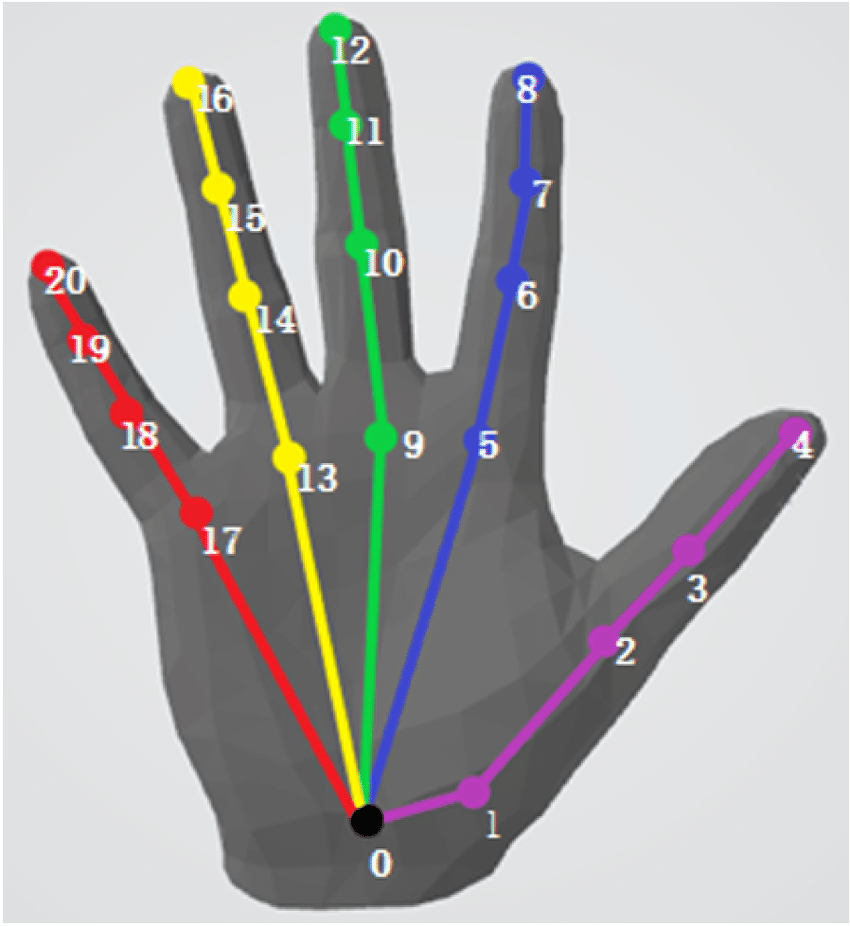
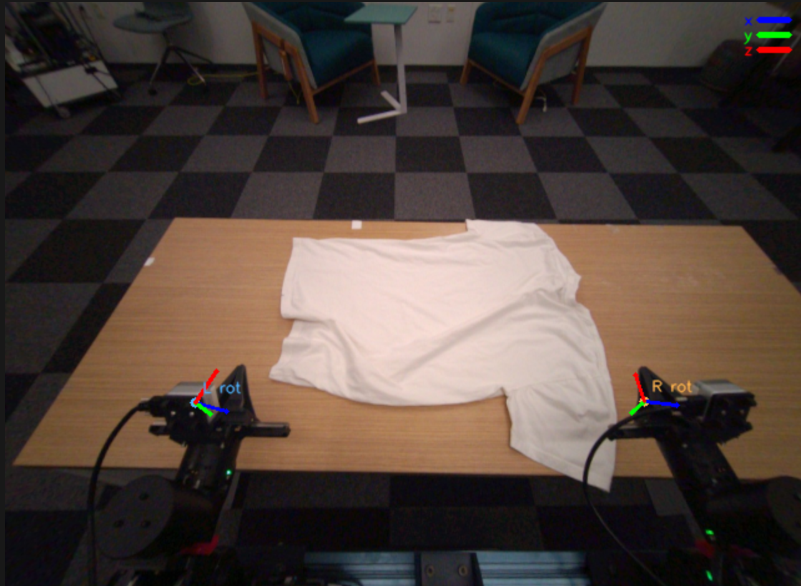

# EgoVerse Data Contribution Guide

*For new labs and companies contributing egocentric human demonstration data to the EgoVerse consortium.*

RL2 team members: ingest, the episode database and the internal converters are documented in [INTERNAL_DATA.md](INTERNAL_DATA.md).

---

## Table of Contents

1. [Overview](#1-overview)
2. [Dataset Practices](#2-dataset-practices)
3. [Prerequisites](#3-prerequisites)
4. [Episode Hash Convention](#4-episode-hash-convention)
5. [Episode Registry (handled by RL2)](#5-episode-registry-handled-by-rl2)
6. [Zarr v3 Episode Format](#6-zarr-v3-episode-format)
7. [Coordinate Frame Conventions](#7-coordinate-frame-conventions)
8. [Language Annotations](#8-language-annotations)
9. [Embodiment Identifiers](#9-embodiment-identifiers)
10. [Uploading to S3](#10-uploading-to-s3)
11. [Validation and Verification](#11-validation-and-verification)
12. [Pre-Submission Checklist](#12-pre-submission-checklist)
13. [Getting Access and Contact](#13-getting-access-and-contact)

---

## 1. Overview

EgoVerse is a multi-lab egocentric human demonstration dataset for robot co-training. The primary storage and training format is **EgoVerse's own Zarr v3 schema**. 

Every contributed episode must satisfy these check lists:

| Contract | What it enforces |
|---|---|
| **File format** | Zarr v3 store with specific key names, dtypes, and shapes |
| **Coordinate frame** | All poses expressed in a consistent reference frame |
| **Metadata** | Per-episode `task_name`, `operator`, `lab`, `scene`, `objects` in `zarr.attrs` (§6.3); RL2 registers the episode on ingest (§5) |
| **[Dataset Practices](#2-dataset-practices)** | Example: reducing idle times, check for data flaws |

The pipeline at a glance:

```
Your raw data
    └─► Convert to Zarr v3 (start from the reference converter, §6.0)
    └─► Validate every episode (§11)
    └─► Upload to s3://rldb/processed_v3/<lab>/<episode_hash>.zarr/ (§10)
    └─► Upload the raw recordings to s3://rldb/raw/<lab>/<vendor_recording_id>/ (§6.6)
    └─► RL2 registers the episodes; they become available through S3MultiDataset
```

---

## 2. Dataset Practices

*What to capture, and how to keep it clean.*

We want to capture **economically useful work performed by a proficient demonstrator**.

### 2.1 Target Data Composition

A rough heuristic for the data **in aggregate**:

| Dimension | Target mix |
|---|---|
| **Task type** | no more than ~5% navigation · ~10% mobile manipulation · ~85% manipulation |
| **Gripper** | ~60% doable with a parallel-jaw gripper · ~40% doable by either a parallel-jaw gripper or a dexterous hand |
| **Setting** | ~70% tabletop · ~30% non-tabletop |

### 2.2 Capture Settings

Data can range from **staged studios** (realistic work captured in a controlled setting) all the way to **in the wild** — people doing tasks at home or in factory settings. If you are capturing real labor in the wild, it is **especially important to trim down to the relevant portions.**

### 2.3 Quality — Avoid These Failure Modes

A common failure mode is the demonstrator **randomly stalling, inspecting an item, patting clothes**, etc. Capture proficient, purposeful execution — not idle filler.

### 2.4 Trimming Rules

- **Trim out aggressive head movements.**
- **Hand tracking must be visible in all frames** — trim out any frames without hands.
- In-the-wild captures: **trim down to the task-relevant portions** (drop setup, breaks, wandering).

### 2.5 Example Tasks

Some example tasks we would prefer:

| # | Task | What it covers |
|---|---|---|
| 1 | **Sorting** | Sort parts/components into bins by type, color, or size (factory); sort utensils into a cutlery tray, or sort a cluttered table by category (food / tool / toy), color, or shape (home). |
| 2 | **Packing** | Place items into a box, bin, or bag with room to spare (loose packing, not tight-fit). |
| 3 | **Opening & closing containers** | Drawers, cabinet doors, box lids/flaps, bags (ziploc, drawstring). |
| 4 | **Tidying a cluttered table** | Return scattered objects to their places / into containers (dry, no wiping). |
| 5 | **Spatial arrangement** | Arrange objects into an approximate target layout: line up, group by type, set out in roughly canonical positions (exact spacing not required). |
| 6 | **Stacking** | Stack wide, stable items (plates, bowls, books) or nest bowls; no precise tall towers. |
| 7 | **Folding** | Rough-fold towels / cloth / clothing in half or thirds; crisp creases not required. |
| 8 | **Capping & uncapping** | Place or remove loose lids on boxes/jars, or large-thread caps; no fine threading. |
| 9 | **Hanging** | Drape a cloth/towel over a rod, or hang a bag/mug on a large hook; generous targets. |
| 10 | **Shelving** | Place books/boxes onto an open shelf with free space; no tight insertion. |
| 11 | **Loading & unloading** | Load items into a tray, caddy, or dish rack with generous slots; unload onto the table. |
| 12 | **Buttons & switches** | Press large buttons, flip switches, toggle controls. |
| 13 | **Retrieval by description** | Pick a specified item from a mixed set and bring it to a drop zone — e.g. "the red mug," "the biggest book," "the metal one." Delivery to a zone, not a precise pose. |
| 14 | **Relational placement** | Place an object relative to another by instruction: to the left of, behind, between, or on top of a reference object. Approximate positions are fine. |
| 15 | **Matching & pairing** | Pair like items (socks, gloves, shoes), match lids to their containers, or match an object to its printed outline. Forgiving placement. |
| 16 | **Reorientation & flipping** | Turn objects to a target pose: stand cups upright, flip cards face-up, or rotate items so labels face front. Forgiving rotation, no exact angle. |
| 17 | **Search & retrieve** | Open a drawer/box, find a specified item inside, and take it out (combines opening, selection, and extraction). |

---

## 3. Prerequisites

### 3.1 Hardware

EgoVerse is hardware-agnostic. Any egocentric camera with a SLAM system that provides 6-DOF pose tracking is supported. The minimum requirements are:

| Item | Requirement |
|---|---|
| Egocentric camera | Any camera worn or mounted on the head/torso providing a first-person RGB stream at ≥ 30 fps. Examples: Project Aria glasses, OAK-D, ZED Mini, RealSense T265, GoPro + external SLAM. |
| SLAM / pose tracking | A system that outputs 6-DOF device pose in a consistent metric world frame at ≥ 30 fps, synchronized with the RGB stream. Examples: Aria MPS, ZED SDK positional tracking, ORB-SLAM3, OpenVINS, RealSense tracking firmware. |
| Hand tracking | Per-frame 3D hand landmark estimates (21 keypoints per hand) synchronized to the RGB stream, expressed in the same SLAM world frame. Examples: Aria MPS hand tracking, MediaPipe + depth unprojection, OAK-D depthai hand tracker, Ultraleap. If your setup does not produce hand keypoints, omit `*.obs_keypoints` and `*.obs_wrist_pose` and use only `*.obs_ee_pose` (e.g. derived from a robot's FK or a wrist-worn IMU). |
| Wrist cameras | Optional. Include as `images.left_wrist` / `images.right_wrist` if present. |
| Robot | Any bimanual arm or single-arm platform. See §9 for embodiment identifiers. |

**Minimum viable setup (no robot):** egocentric camera + SLAM + hand tracking → contributes `images.front_1`, `obs_head_pose`, `left/right.obs_ee_pose`, `left/right.obs_wrist_pose`, `left/right.obs_keypoints`.

**If your SLAM system does not run at the RGB frame rate**, upsample or interpolate pose tracks to match it before writing. The training pipeline assumes all arrays are frame-aligned. The RGB stream must be 30 or 60 fps; the validator rejects any other rate (§11.1).

### 3.2 Software

```bash
# Clone and install EgoVerse (or clone over HTTPS: https://github.com/GaTech-RL2/EgoVerse.git)
git clone git@github.com:GaTech-RL2/EgoVerse.git
cd EgoVerse
uv venv --python 3.11
source .venv/bin/activate
uv pip install -e .
```

The reference converter writes an MP4 preview per episode (§6.5), which needs
[`ffmpeg`](https://ffmpeg.org/) on your `PATH` (e.g. `apt install ffmpeg` or
`brew install ffmpeg`). `s5cmd`, used for uploads (§10), is installed with the
Python environment. The `aws` CLI is optional.

### 3.3 Credentials

You only need Cloudflare R2 credentials for the data bucket. An RL2 team member
sends them to you directly. Upload only under your `lab` prefixes (§10.1). You do not need
AWS account keys or database access: RL2 registers your episodes (§5).

Set them in your environment. `s5cmd` reads the `AWS_*` names; the Python
upload helper (§10.2) reads the `R2_*` names, so set both:

```bash
export AWS_ACCESS_KEY_ID=<R2 access key from your RL2 contact>
export AWS_SECRET_ACCESS_KEY=<R2 secret from your RL2 contact>
export AWS_ENDPOINT_URL_S3=<R2 endpoint URL from your RL2 contact>
export AWS_DEFAULT_REGION=auto
export R2_ACCESS_KEY_ID="$AWS_ACCESS_KEY_ID"
export R2_SECRET_ACCESS_KEY="$AWS_SECRET_ACCESS_KEY"
export R2_ENDPOINT_URL="$AWS_ENDPOINT_URL_S3"
```

Instead of exporting the `R2_*` names, you can put those three `KEY=value` lines
in `~/.egoverse_env`; the Python helpers load that file.

Verify (should list your prefix, or return empty without erroring):

```bash
s5cmd --endpoint-url "$AWS_ENDPOINT_URL_S3" ls "s3://rldb/processed_v3/<lab>/*"
```

Every call needs the R2 endpoint (`--endpoint-url`); against AWS's own servers
the bucket returns AccessDenied.

---

## 4. Episode Hash Convention

Every episode is identified by a **UTC timestamp** rendered as:

```
YYYY-MM-DD-HH-MM-SS-ffffff
```

where `ffffff` is microseconds zero-padded to 6 digits.

Examples:
```
2025-10-14-04-15-30-000000
2026-01-12-03-47-29-664000
```

**Rules:**
- The episode hash is the episode's ID in the EgoVerse registry. It must be globally unique, so never reuse one across your deliveries.
- Use the UTC wall-clock time at the **start of the recording** as the hash.
- If your hardware does not produce a UTC timestamp natively, convert from device clock using a synchronized offset.
- The helpers take **milliseconds** since the Unix epoch. Passing seconds gives a 1970 hash; passing nanoseconds fails.
- The `.zarr` directory on S3 is named exactly `<episode_hash>.zarr`.

**Python helpers:**
```python
from egomimic.utils.aws.aws_sql import episode_hash_to_timestamp_ms, timestamp_ms_to_episode_hash

# Convert a UTC epoch millisecond integer to an episode hash string
hash_str = timestamp_ms_to_episode_hash(1768189649664)
# → "2026-01-12-03-47-29-664000"

# Convert back
ts_ms = episode_hash_to_timestamp_ms("2026-01-12-03-47-29-664000")
# → 1768189649664
```

---

## 5. Episode Registry (handled by RL2)

Every episode is listed in an internal registry that the download and training
tooling reads. **RL2 adds your episodes to it on ingest; you do not need database
access.** Upload the `.zarr` stores and `.mp4` previews with the attributes from
§6.3 (§10), and the registry row is built from them. The internal schema and
ingest steps are in [INTERNAL_DATA.md](INTERNAL_DATA.md).

---

## 6. Zarr v3 Episode Format

Each episode is a **Zarr v3 group** (a directory ending in `.zarr`) containing arrays and top-level attributes.

### 6.0 Writing Your Converter

Start from the reference converter, [`egomimic/scripts/convert_template/template_to_zarr.py`](egomimic/scripts/convert_template/template_to_zarr.py). Copy it and replace two functions:

- `find_raw_episodes(raw_root)` — one entry per raw episode in your layout.
- `load_episode(raw_path)` — return a `RawEpisode`: the image stream, head and hand poses as `(T, 7)` xyz + wxyz quaternion in your SLAM world frame (§7), optional `(T, 63)` keypoints, the camera K, the recording start time in UTC epoch milliseconds (§4), **that episode's** `task_name` / `operator` / `lab` / `scene` / `objects` (§6.3) read from your own capture logs, and the `vendor_recording_id` of the raw recording it was cut from (§6.6).

The rest is handled for you: the `<episode_hash>.zarr` name, the `ZarrWriter` call with the correct `human_*` embodiment and intrinsics, validation of every episode right after it is written (§11.1 — a failing episode is deleted and reported, the batch keeps going), and the MP4 preview (§6.5). Run it on a folder, or call `convert_all(paths, output_dir, workers=N)` from your own batch script:

```bash
python egomimic/scripts/convert_template/template_to_zarr.py --raw-root /raw --output-dir /out --workers 8
```

As shipped, `load_episode` returns synthetic data with `lab="template"`, which the validator rejects; set `lab` to your own id and you can run the template end to end before writing the rest of your loader. Re-running into an `--output-dir` that already holds an episode fails that episode (`FileExistsError`), so write each batch to a fresh directory. If an episode has `scene` or `objects` set to `MissingMetadata()` (§6.3), add `--allow-missing`; otherwise it is deleted. The MP4 preview needs `ffmpeg`; if it fails, the episode is kept and a warning is logged (`--no-mp4` skips previews). The sections below are the spec it implements.

### 6.1 Directory Structure

```
<episode_hash>.zarr/
├── zarr.json                       ← top-level group metadata + episode attrs
├── annotations/                    ← language annotations (may be empty)
│   ├── zarr.json
│   └── c/                          ← chunk data
├── images.front_1/                 ← egocentric RGB frames (required)
│   ├── zarr.json
│   └── c/
├── images.left_wrist/              ← left wrist camera RGB frames (optional)
│   ├── zarr.json
│   └── c/
├── images.right_wrist/             ← right wrist camera RGB frames (optional)
│   ├── zarr.json
│   └── c/
├── left.obs_ee_pose/               ← left end-effector pose (required for bimanual)
├── right.obs_ee_pose/              ← right end-effector pose (required for bimanual)
├── left.obs_wrist_pose/            ← left wrist pose (required if hand tracking available)
├── right.obs_wrist_pose/           ← right wrist pose (required if hand tracking available)
├── left.obs_keypoints/             ← left hand keypoints (required if hand tracking available)
├── right.obs_keypoints/            ← right hand keypoints (required if hand tracking available)
├── left.obs_gripper/               ← left gripper state (required if parallel gripper)
├── right.obs_gripper/              ← right gripper state (required if parallel gripper)
├── left.cmd_gripper/               ← left gripper command (required if parallel gripper)
├── right.cmd_gripper/              ← right gripper command (required if parallel gripper)
├── obs_head_pose/                  ← egocentric device pose (required)
├── obs_eye_gaze/                   ← eye gaze direction (if available)
└── obs_rgb_timestamps_ns/          ← per-frame capture timestamps
```

### 6.2 Required Arrays

All arrays are indexed along axis 0 by frame index. **`zarr.attrs["total_frames"]` is the
authoritative episode length**: every array covers frames `[0, total_frames)` along axis 0.
Arrays MAY extend past `total_frames` with zero-padding (writers commonly pad to a chunk
boundary — e.g. `ZarrWriter` pads to `chunk_timesteps`); consumers must slice
`[:total_frames]` and never interpret the padded tail as data.

#### Images

| Key | Shape | Dtype | Notes |
|---|---|---|---|
| `images.front_1` | `(T,)` of variable-length bytes | `VariableLengthBytes` | JPEG-encoded RGB frames |
| `images.left_wrist` | `(T,)` of variable-length bytes | `VariableLengthBytes` | Optional. Include if wrist camera present. |
| `images.right_wrist` | `(T,)` of variable-length bytes | `VariableLengthBytes` | Optional. Include if wrist camera present. |

#### Egocentric Device Pose (all contributors)

| Key | Shape | Dtype | Frame | Notes |
|---|---|---|---|---|
| `obs_head_pose` | `(T, 7)` | `float64` | SLAM world frame | 6-DOF pose of the egocentric camera/device as xyz + wxyz. This is the pivot used at training time to re-express all other poses into head-relative coordinates. **Required for all contributors.** |

#### Hand and Wrist Poses (if hand tracking is available)

Provide these if your setup produces 3D hand estimates. Omit the entire key (do not write zeros) if not available.

| Key | Shape | Dtype | Frame | Notes |
|---|---|---|---|---|
| `left.obs_ee_pose` | `(T, 7)` | `float64` | SLAM world frame | Left hand end-effector (fingertip centroid or palm center) pose as xyz + wxyz. If you have keypoints, derive this from them — see [Deriving `obs_ee_pose` from MANO keypoints](#deriving-obs_ee_pose-from-mano-keypoints-recommended) |
| `right.obs_ee_pose` | `(T, 7)` | `float64` | SLAM world frame | Right hand end-effector pose as xyz + wxyz (same derivation guidance as the left) |
| `left.obs_wrist_pose` | `(T, 7)` | `float64` | SLAM world frame | Left wrist origin pose as xyz + wxyz |
| `right.obs_wrist_pose` | `(T, 7)` | `float64` | SLAM world frame | Right wrist origin pose as xyz + wxyz |
| `left.obs_keypoints` | `(T, 63)` | `float64` | SLAM world frame | 21 hand landmarks × 3 (x, y, z); flattened row-major (see ordering below) |
| `right.obs_keypoints` | `(T, 63)` | `float64` | SLAM world frame | 21 hand landmarks × 3 (x, y, z); flattened row-major |

**If your system only provides wrist pose (not full keypoints)**, include `*.obs_wrist_pose` and `*.obs_ee_pose` and omit `*.obs_keypoints`.

**If your system provides only a single aggregate hand pose** (e.g. palm center from a depth sensor), populate `*.obs_ee_pose` only.

Keypoint ordering (21 landmarks):
Use the keypoints convention of MANO.



If you need to convert your proprietary keypoints to MANO, try using [otaheri/MANO](https://github.com/otaheri/MANO).

##### Deriving `obs_ee_pose` from MANO keypoints (recommended)

**Derive `*.obs_ee_pose` from your fitted MANO keypoints.** The frame is built
directly from the landmarks: the translation is a palm-center stand-in — the
centroid of the wrist and the index/middle/ring MCPs (joints `0, 5, 9, 13`) —
and the orientation is built from the wrist→palm direction plus a palm normal
taken as `(index_MCP − wrist) × (pinky_MCP − wrist)`, sign-flipped for the left
hand so the normal points out of the palm on both sides. Frames with missing or
degenerate keypoints carry the `1e9` sentinel. Output is `(T, 7)` xyz + wxyz,
the same layout as every other pose key. **Trim sentinel frames before writing**
(§2.4): a single `1e9` frame has a non-unit quaternion, which fails the whole
episode in the validator (§11.1). NaN or inf values fail it too. EgoVerse provides this as
`mano_keypoints_to_cartesian` in
[`egomimic/scripts/aria_process/aria_utils.py`](egomimic/scripts/aria_process/aria_utils.py):

```python
from egomimic.scripts.aria_process.aria_utils import mano_keypoints_to_cartesian

# mano_kp: (T, 63) canonical-MANO keypoints in the SLAM world frame,
#          i.e. exactly what you store in <side>.obs_keypoints
ee_pose = mano_keypoints_to_cartesian(mano_kp, is_rhand=True)   # -> (T, 7)
```


#### Robot Arm Poses (if operating alongside a robot)

| Key | Shape | Dtype | Notes |
|---|---|---|---|
| `left.obs_ee_pose` | `(T, 7)` | `float64` | Left arm EEF pose as xyz + wxyz in robot base frame |
| `right.obs_ee_pose` | `(T, 7)` | `float64` | Right arm EEF pose as xyz + wxyz in robot base frame |
| `left.obs_gripper` | `(T, 1)` | `float64` | Left gripper aperture in [0, 1] (0 = fully closed) |
| `right.obs_gripper` | `(T, 1)` | `float64` | Right gripper aperture in [0, 1] |
| `left.cmd_ee_pose` | `(T, 7)` | `float64` | Commanded left EEF pose (if available) |
| `right.cmd_ee_pose` | `(T, 7)` | `float64` | Commanded right EEF pose (if available) |
| `left.cmd_gripper` | `(T, 1)` | `float64` | Commanded left gripper (if available) |
| `right.cmd_gripper` | `(T, 1)` | `float64` | Commanded right gripper (if available) |

#### Timestamps and Misc

| Key | Shape | Dtype | Notes |
|---|---|---|---|
| `obs_rgb_timestamps_ns` | `(T,)` | `int64` | UTC nanoseconds for each RGB frame |
| `obs_eye_gaze` | `(T, 3)` | `float64` | Unit gaze direction vector in SLAM world frame (x, y, z) |

### 6.3 Top-Level Attributes (`zarr.attrs`)

The root group's `.attrs` dictionary is the **episode metadata**. It is written as JSON and is the primary indexing surface.

```python
{
    "schema_version":    int,   # set by ZarrWriter (currently 1); do not set it yourself
    "embodiment":        str,   # e.g. "human_bimanual" (§9)
    "total_frames":      int,   # number of valid frames (not padded)
    "fps":               int,   # capture frame rate: 30 or 60
    "task_name":         str,   # e.g. "fold_clothes" (you propose it, see below)
    "task_description":  str,   # free-text description of the trial
    "operator":          str,   # per-episode ID of the person who collected it
    "lab":               str,   # who the data came from: short lowercase id, e.g. "mecka"
    "scene":             str,   # scene / location label
    "objects":     list[str],   # objects manipulated
    "vendor_recording_id": str, # REQUIRED: raw recording this episode was cut from (§6.6)
    "intrinsics":        dict,  # MANDATORY: {camera_key: 3x4 K matrix} dict (single-camera =
                                #   one entry, e.g. {"front_1": K}; 3x4 = the 3x3 pinhole K
                                #   with a zero last column). Projection uses the "front" entry.
    "extrinsics":  dict | None, # None, or a non-empty dict of 4x4 world<-cam transforms.
                                #   Robots key per-arm, e.g. {"left": T, "right": T}.
                                #   Egocentric human contributors omit it (None).
    "features": {
        "<key>": {
            "dtype":  str,        # numpy dtype string, or "jpeg" for images, "json" for annotations
            "shape":  list[int],  # per-frame shape (no time dimension)
            "names":  list[str],  # dimension labels (e.g. ["dim_0"] or ["height", "width", "channel"])
            # images only:
            # "dtype": "jpeg", "shape": [H, W, 3], "names": ["height", "width", "channel"]
            # annotations only:
            # "dtype": "json", "shape": [N], "names": ["json"], "format": "annotation_v1"
        },
        ...
    }
}
```

**Rules:**
- `total_frames` must equal `len(store["images.front_1"])` and every other non-padded array.
- `fps` must be the actual capture rate of `images.front_1`, and must be 30 or 60. Do not set it to a target rate if the actual rate differs.
- `features` must have one entry per array key present in the store.
- `vendor_recording_id` is **required**: it is how we find the raw recording again (§6.6), and with `lab` it gives the recording's ID downstream. Pass it as `ZarrWriter.create_and_write(..., vendor_recording_id=...)`; the reference converter does this from `RawEpisode.vendor_recording_id`. It must be a single path component (no `/`), with no placeholder or surrounding whitespace.
- `intrinsics` is **mandatory** and is a `{camera_key: 3×4 K matrix}` dict in `zarr.attrs` (single-camera = one entry, e.g. `{"front_1": K}`). `ZarrWriter.create_and_write` raises if it is not a non-empty dict. The one exception is `dexmate_bimanual` (§9), whose source has no camera calibration: it may pass `intrinsics=MissingMetadata()`, stored as an explicit `null` (§6.4).
- `extrinsics` is **either `None` or a non-empty `dict`** of 4×4 world↔cam transforms (robots key per-arm, e.g. `{"left": T, "right": T}`); egocentric human contributors omit it (`None`). `ZarrWriter.create_and_write` raises if it is anything other than `None` or a non-empty dict.

#### Required metadata fields (`task_name`, `operator`, `lab`, `scene`, `objects`)

These are what let people filter the data and train on it — per-operator splits, held-out scenes, object-conditioned subsets. **`task_name`, `operator` and `lab` are always required and cannot be waived.** We heavily recommend providing `scene` and `objects` for every episode too. `ZarrWriter.create_and_write` takes each as a required keyword argument with **no default**, and raises `ValueError` on an empty string, a placeholder (`"unknown"`, `"none"`, `"n/a"`, `"tbd"`, `"debug"`, `"test"`, …), or a value with leading or trailing whitespace.

- `task_name`: propose your own short, stable, lowercase name for the task category, e.g. `fold_clothes` or `object_in_container` — not a one-off trial description. RL2 maps it to the existing task list on ingest. Put trial-specific detail in `task_description`, `scene` and `objects`.
- `operator` is per-episode — use your own stable collector ID (a pseudonymous ID is fine).
- `lab` names who the data came from. It must be a full match of `^[a-z0-9][a-z0-9_-]*$`, is the same string as your S3 prefix (§10.1), and must never change once chosen.
- `objects` is a list of names, or a comma-separated string (`"shirt, basket"`), which is stored as a list. Every entry is checked the same way as the other fields.

If your source data genuinely has no `scene` or `objects`, you must say so explicitly:

```python
from egomimic.rldb.zarr.required_metadata import MissingMetadata

ZarrWriter.create_and_write(
    ...,
    scene=MissingMetadata(),
)
```

Only do this if absolutely necessary; it is rejected for `task_name`, `operator` and `lab`. The field is then stored as `null`, and the validator (§11.1) fails the episode unless it is run with `--allow-missing`. With the reference converter (`template_to_zarr.py`), pass `--allow-missing` (or `allow_missing=True` to `convert_all`); otherwise it deletes the episode. Episodes converted this way are accepted, and the `null` fields are visible in `zarr.json`.

### 6.4 Storage / Chunking

> # ⚠️ **USE THE [`ZarrWriter`](egomimic/rldb/zarr/zarr_writer.py) CLASS** ⚠️
> # **This is the only supported way to produce EgoVerse Zarr stores. It guarantees sharding and chunking match the rest of the dataset — do NOT roll your own writer.**

- **Numeric arrays**: chunk shape `(chunk_timesteps, *frame_shape)` with `chunk_timesteps=100`, sharded to full array shape.
- **Image arrays**: chunk shape `(1,)` (one JPEG blob per chunk), sharded to full array shape.
- **Annotation arrays**: chunk shape `(N,)`, sharded to `(N,)`.
- **Zarr format version**: always **v3** (`zarr_format=3`).

See the reference converter (§6.0) for a complete example.

#### Camera intrinsics & extrinsics — **how to store them**

Do **not** hand-write these into `zarr.attrs` yourself. Pass them to `ZarrWriter.create_and_write` (or the `ZarrWriter(...)` constructor) via the `intrinsics=` / `extrinsics=` arguments; the writer serializes them into `zarr.attrs` under the `"intrinsics"` / `"extrinsics"` keys (§6.3).

- **`intrinsics` is a REQUIRED `dict`** of the form `{camera_key: 3x4 K matrix}` — `create_and_write` raises a `ValueError` if it is not a non-empty dict. **Single-camera setups still use a dict — just one entry**, e.g. `{"front_1": K}`. (Always a dict, so downstream code has one clear structure to handle; the only exception is an uncalibrated `dexmate_bimanual` episode, below.)
- Each value is a **3×4** K matrix: the standard 3×3 pinhole matrix with an appended **zero column** (i.e. `[K | 0]`). A bare 3×3 is rejected on the projection path — pad it with `np.hstack([K_3x3, np.zeros((3, 1))])`.
- **Multi-camera rigs:** add one entry per camera, e.g. `{"front_1": K_front, "left_wrist": K_lw, "right_wrist": K_rw}`. The training/viz projection uses the **front-camera** entry (the key containing `front`), so make sure that one is present and correct.
- **`extrinsics`** is **`None` or a non-empty `dict`** of 4×4 world↔cam transforms — `create_and_write` raises on anything else. **Robots** key it **per-arm**, e.g. `{"left": T_left, "right": T_right}`; egocentric **human** contributors pass `None` (omit it).
- **No calibration (`dexmate_bimanual` only).** A Dexmate episode whose source has no camera calibration passes `intrinsics=MissingMetadata()`; the writer stores `"intrinsics": null`. The validator (§11.1) fails it unless run with `--allow-missing`, and then warns. For every other embodiment `MissingMetadata()` or `None` still raises, and a stored `null` fails validation even with `--allow-missing`. An episode with no `intrinsics` key at all always fails. Training keeps working without them (the batch gets a NaN `intrinsics` placeholder), but nothing can be projected onto the image.

```python
import numpy as np
from egomimic.rldb.zarr.zarr_writer import ZarrWriter

# fx=fy=248.57, cx=320, cy=180  ->  3x4 K (note the zero last column)
K_front = np.array([
    [248.57,   0.0,   320.0, 0.0],
    [  0.0,  248.57,  180.0, 0.0],
    [  0.0,    0.0,     1.0, 0.0],
])

ZarrWriter.create_and_write(
    episode_path="path/to/<episode_hash>.zarr",
    embodiment="human_bimanual",
    numeric_data=numeric_arrays,        # left/right.obs_ee_pose, obs_head_pose, ...
    image_data=image_arrays,            # images.front_1, ...
    intrinsics={"front_1": K_front},    # REQUIRED — always a {camera_key: 3x4} dict
    # extrinsics=...,                   # optional; robots key it per arm
    fps=30,
    task_name="...",                    # REQUIRED metadata fields, see §6.3
    operator="...",
    lab="...",
    scene="...",
    objects=["..."],
    task_description="...",
)
```

### 6.5 Episode Preview MP4 (sibling artifact)

Alongside each `<episode_hash>.zarr` store, write a preview video of the egocentric RGB stream named **`<episode_hash>.mp4`** (e.g. `2026-03-15-14-22-10-000000.mp4`). The Mecka AI dataset viz looks previews up by this exact filename, so any deviation from the `<episode_hash>.mp4` convention will break it.

Any standard MP4 encoder works. The reference converter (§6.0) writes it for you with the [`save_preview_mp4`](egomimic/utils/video_utils.py) helper (needs `ffmpeg`, §3.2), next to the `.zarr` directory. Upload it next to the zarr as well: `s3://rldb/processed_v3/<lab>/<episode_hash>.mp4` (§10).

### 6.6 Raw Data (alongside the Zarr)

Zarr is what we train on, so deliver it first. Also upload the **raw recordings** each
episode was converted from, so we can rebuild the data later (new formats, higher
resolution, different processing) without coming back to you.

- **Any format.** Send raw data the way your pipeline stores it. Use the raw-data
  reference, [`egomimic/rldb/mcap/SPEC.md`](egomimic/rldb/mcap/SPEC.md), as the checklist
  of what it should contain: per-camera calibration, capture timestamps on every
  stream, raw IMU, head / hand (or arm) poses with tracking validity, transforms between
  frames, and the §6.3 metadata (`task_name`, `operator`, `lab`, `scene`, `objects`).
- **Include video**, as the device stores it or lightly compressed (e.g. H.264 / H.265 at
  a high-quality setting). Keep the original resolution and frame rate: no downscaling or
  cropping, and encode at most once.
- **One folder per raw recording session**, at
  `s3://rldb/raw/<lab>/<vendor_recording_id>/`. `vendor_recording_id` is your own stable
  ID for the session; keep it the same across re-exports and corrections.
- **Link each zarr episode to its session** with the `vendor_recording_id` attribute
  (§6.3). One session can be trimmed into several zarr episodes (§2.4); each of them
  carries the same `vendor_recording_id`. This link is required and validated (§11.1).
- **If you use MCAP**, follow SPEC.md exactly (its episode info uses the same
  `vendor_recording_id` key) and check every episode with
  `python -m egomimic.rldb.mcap.validate episode_<id>/ [...]`; `scene` / `objects` waived in
  `missing_metadata` fail unless `--allow-missing`, as for Zarr; `task_name`, `operator`
  and `lab` cannot be waived.

---

## 7. Coordinate Frame Conventions

### 7.1 SLAM World Frame (storage frame)

All poses are stored in the **SLAM world frame** produced by your pose-tracking system (e.g. Aria MPS, ZED SDK, ORB-SLAM3). This is an arbitrary fixed Euclidean frame that is consistent within a single recording session but **not** consistent across sessions or between different hardware setups.

- Origin: defined by the SLAM system at recording start; treat as opaque.
- Axes: right-handed, metric (meters).
- **This is what you write into the Zarr arrays.** Do not pre-transform poses to any other frame before writing.

The SLAM world frame origin and orientation will differ between labs and hardware. That is expected and fine — the training-time head-frame normalization (§7.2) cancels out any global offset or rotation.

### 7.2 Head Frame (training frame)

At training time, the pipeline automatically re-expresses all poses **relative to the current egocentric device pose** (`obs_head_pose`) using `ActionChunkCoordinateFrameTransform`. You do **not** need to do this conversion yourself; it is applied on-the-fly by the data loader.

The head frame is:
- Origin: the egocentric camera/device center at the current timestep.
- +X: right.
- +Y: down.
- +Z: forward (into the scene from the camera).

The end-effector frame uses the same convention (+X right, +Y down, +Z forward).



### 7.3 Wrist Frame (optional training frame)

For keypoint-based models, keypoints can optionally be further expressed relative to the wrist frame via `PoseCoordinateFrameTransform`. Again, this is a training-time transform; store everything in the SLAM world frame.

### 7.4 Frame Summary

| Array | Written in | Re-expressed at train time |
|---|---|---|
| `left.obs_ee_pose` | SLAM world | Head frame |
| `right.obs_ee_pose` | SLAM world | Head frame |
| `left.obs_wrist_pose` | SLAM world | Head frame |
| `right.obs_wrist_pose` | SLAM world | Head frame |
| `left.obs_keypoints` | SLAM world | Head frame, then optionally wrist frame |
| `right.obs_keypoints` | SLAM world | Head frame, then optionally wrist frame |
| `obs_head_pose` | SLAM world | Used as the re-expression pivot; deleted from batch after transform |
| `obs_eye_gaze` | SLAM world | Not re-expressed (stored as unit direction) |
| Robot `*.obs_ee_pose` | Robot base frame | Robot base frame (no re-expression) |

---

## 8. Language Annotations

Language annotations are **optional but strongly encouraged**. They are stored as a span-based structure: each annotation covers a contiguous range of frames.

### 8.1 Format (`annotation_v1`)

The `annotations` array in the Zarr store contains `N` entries, where `N` is the total number of annotation spans in the episode (not the number of frames). Each entry is a UTF-8-encoded JSON string:

```json
{"text": "pick up the shirt", "start_idx": 0, "end_idx": 145}
```

| Field | Type | Description |
|---|---|---|
| `text` | `str` | Natural-language description of what is happening during `[start_idx, end_idx)` |
| `start_idx` | `int` | First frame index (inclusive) |
| `end_idx` | `int` | One past the last frame (exclusive). Must satisfy `0 <= start_idx <= end_idx <= total_frames`; a span covering the whole episode is `(0, total_frames)`. |

**Rules:**
- Spans may overlap.
- Spans do not need to cover the entire episode.
- `text` must be in English.
- Use the imperative or present-continuous form: "pick up the shirt", "folding the left sleeve", etc.
- Do **not** encode task-level descriptions here (those go in `task_description`). Use annotations for sub-step descriptions.
- An empty `annotations` array (shape `(0,)`) is valid when no annotation is available.

### 8.2 Annotation Granularity

Use at minimum one annotation per task phase. For `fold_clothes`, for example:

| Phase | Example annotation text |
|---|---|
| Grasp | "grasping the shirt by the collar" |
| Unfold | "unfolding and laying the shirt flat" |
| Fold left sleeve | "folding the left sleeve towards the center" |
| Fold right sleeve | "folding the right sleeve towards the center" |
| Fold body | "folding the bottom half up to complete the fold" |

### 8.3 Writing Annotations

Via `ZarrWriter`:
```python
from egomimic.rldb.zarr.zarr_writer import ZarrWriter

annotations = [
    ("grasping the shirt by the collar",        0,   145),
    ("unfolding and laying the shirt flat",    145,   420),
    ("folding the left sleeve towards center", 420,   680),
    ("folding the right sleeve",               680,   910),
    ("folding the bottom half up",             910,  1200),
]

ZarrWriter.create_and_write(
    episode_path="path/to/<episode_hash>.zarr",
    embodiment="human_bimanual",
    fps=30,
    task_description="folding a 2T baby shirt",
    annotations=annotations,
    intrinsics={"front_1": K_front},
    task_name="fold_clothes",
    operator="...", lab="...", scene="...", objects=["baby_shirt_2T"],  # §6.3
    # numeric_data=..., image_data=...
)
```

To write annotations into an **existing** Zarr store (keeps `features` in sync):
```python
from egomimic.rldb.zarr.zarr_writer import write_annotations

write_annotations(
    "path/to/<episode_hash>.zarr",
    annotations,
    annotation_key="annotations",
    mode="w",   # "w" = replace an existing key, "a" = add a new key only
)
```

---

## 9. Embodiment Identifiers

The `embodiment` field in `zarr.attrs` must be exactly one of the strings below. **All human demonstration data is a single `human` embodiment — there is no per-vendor or per-hardware embodiment.** The lab / hardware that produced the data is recorded separately in the `lab` field (`zarr.attrs`, §6.3), never in `embodiment`. Each robot is its own embodiment: **Eva** and **Dexmate**.

| `embodiment` string | Integer id | Description |
|---|---|---|
| `human_right_arm` | 1 | Egocentric human demonstration, right arm only |
| `human_left_arm` | 2 | Egocentric human demonstration, left arm only |
| `human_bimanual` | 3 | Egocentric human demonstration, two-arm |
| `eva_right_arm` | 4 | Eva camera + right-arm robot |
| `eva_left_arm` | 5 | Eva camera + left-arm robot |
| `eva_bimanual` | 6 | Eva camera + bimanual robot |
| `dexmate_bimanual` | 8 | Dexmate robot with two Sharpa Wave dexterous hands (SharpaDex) |

Ids are never renumbered (normalization stats are keyed by them); 7 is not used.

If you are contributing egocentric human data, you use `human_bimanual` (or the single-arm variants) regardless of your hardware — set the `lab` field (e.g. `lab="microagi"`) to identify your source.

### 9.1 Using the `Human` embodiment (no subclass, no per-vendor identifier)

There is a **single `Human` embodiment class** ([`egomimic/rldb/embodiment/human.py`](egomimic/rldb/embodiment/human.py)) shared by all human data. You do **not** write a per-vendor subclass or register anything in code:

1. Write `embodiment="human_bimanual"` (or `human_left_arm` / `human_right_arm`) in `zarr.attrs` — the reference converter picks it from which hands you track — and record your source in the `lab` field.
2. Put your camera intrinsics in `zarr.attrs` as a `{camera_key: 3x4}` dict (§6.4). They travel with the data; there is no `INTRINSICS` constant in code.

RL2 adds the training data config for your data on ingest.

---

## 10. Uploading to S3

### 10.1 S3 Path Convention

Upload everything under the prefix named by your `lab` (§6.3). Your RL2 contact
confirms the `lab` string when they send your credentials. Write only to these
prefixes; never write to or modify another lab's data.

```
s3://rldb/processed_v3/<lab>/<episode_hash>.zarr/      # the episode (§6)
s3://rldb/processed_v3/<lab>/<episode_hash>.mp4        # its preview (§6.5)
s3://rldb/raw/<lab>/<vendor_recording_id>/             # raw recordings (§6.6)
```

Example:
```
s3://rldb/processed_v3/acmecorp/2026-03-15-14-22-10-000000.zarr/
s3://rldb/processed_v3/acmecorp/2026-03-15-14-22-10-000000.mp4
s3://rldb/raw/acmecorp/session_0412/
```

Upload `.zarr` directories as they are (not archived), so they can be read
directly from the bucket.

### 10.2 Upload with `s5cmd`

`s5cmd` is the recommended upload tool (installed as part of the Python environment).

```bash
# Every validated episode and preview in your output directory
s5cmd --endpoint-url "$AWS_ENDPOINT_URL_S3" \
      sync "/local/out/*" "s3://rldb/processed_v3/<lab>/"

# One raw recording session
s5cmd --endpoint-url "$AWS_ENDPOINT_URL_S3" \
      sync "/local/raw/session_0412/*" "s3://rldb/raw/<lab>/session_0412/"
```

Or using the Python helper (reads the `R2_*` variables, §3.3):
```python
from egomimic.utils.aws.aws_data_utils import upload_dir_to_s3

upload_dir_to_s3(
    local_dir = "/local/out/2026-03-15-14-22-10-000000.zarr",
    bucket    = "rldb",
    prefix    = "processed_v3/<lab>/2026-03-15-14-22-10-000000.zarr",
)
```

---

## 11. Validation and Verification

### 11.1 Automated Checks

Run the validator on every episode before uploading:

```bash
python -m egomimic.rldb.zarr.validate /local/out/*.zarr
```

Pass the `.zarr` directories themselves, not the folder that contains them. It prints `PASS`/`FAIL` per episode with every problem found, and exits nonzero if any episode fails. Add `-v` to also list the checks that passed. It checks:

- metadata (§6.3): `embodiment`, `total_frames`, `fps` (30 or 60), `features`, and the required metadata fields `task_name`/`operator`/`lab`/`scene`/`objects` and `vendor_recording_id`, with the same rules as `create_and_write`
- `embodiment` is a valid identifier (§9)
- the `<episode_hash>.zarr` name decodes to a recording start between 2015 and now (§4); a start time in seconds or nanoseconds instead of milliseconds fails
- `intrinsics` is a non-empty `{camera_key: 3x4}` dict with a front camera (a `dexmate_bimanual` episode may store `null`, §6.4); `extrinsics` is `None` or a dict of 4x4 matrices
- every array has a `features` entry (and vice versa) and at least `total_frames` rows
- required keys: `images.front_1`, `obs_head_pose` (human embodiments), plus `left`/`right.obs_ee_pose` for the arms in the embodiment
- pose arrays are `(T, 7)` with unit quaternions; grippers `(T, 1)`; keypoints last dim 63; no NaN or inf in any of them
- annotations are well-formed `annotation_v1` records within `[0, T]`
- frame 0 of every JPEG key decodes to an RGB image
- `dexmate_bimanual` only: the arm, hand and auxiliary joints, hand keypoints, tactile and `obs_head_link_pose` arrays in [`egomimic/rldb/zarr/dexmate_rules.py`](egomimic/rldb/zarr/dexmate_rules.py) are present (`cmd_hand_keypoints` is optional), have the right width and are finite; observed hand joints more than 0.26 rad past the URDF limits fail. Excursions past 0.035 rad (observed or commanded) and one-frame joint spikes are warnings.

`scene` or `objects` written as `MissingMetadata()` (stored as `null`) fails the check by default, as do the `null` intrinsics of a `dexmate_bimanual` episode; a `null` `task_name`, `operator` or `lab` always fails. `--allow-missing` downgrades it to a warning; only use it once you have confirmed the source data really has no value for that field. Episodes that pass with `--allow-missing` are accepted. From Python, `validate_episode(path)` returns a `ValidationReport` with `.errors`, `.warnings` and `.ok`.

### 11.2 End-to-End Load Test

Verify the episode loads correctly through the full training pipeline before uploading:

```python
from pathlib import Path
from egomimic.rldb.zarr.zarr_dataset_multi import LocalEpisodeResolver, MultiDataset
from egomimic.rldb.filters import DatasetFilter
from egomimic.rldb.embodiment.human import Human
import torch

# cartesian mode re-expresses every pose relative to obs_head_pose, which every
# human episode must have (§6.2, checked by §11.1).
HAS_HEAD_POSE = True
key_map = Human.get_keymap(keymap_mode="cartesian", has_head_pose=HAS_HEAD_POSE)
transform_list = (
    Human.get_transform_list(mode="cartesian_6d", stride=3) if HAS_HEAD_POSE else None
)

resolver = LocalEpisodeResolver(
    folder_path    = Path("/local/processed"),
    key_map        = key_map,
    transform_list = transform_list,
)

filters = DatasetFilter(filter_lambdas=[
    "lambda row: row['episode_hash'] == '2026-03-15-14-22-10-000000'"
])

ds = MultiDataset._from_resolver(resolver, filters=filters, mode="total")
loader = torch.utils.data.DataLoader(ds, batch_size=4, num_workers=0)

# Iterate the entire dataset so any decode/shape/dtype error surfaces,
# not just something in the first batch.
for batch in loader:
    pass
```

Expected output for a valid human bimanual episode in `cartesian_6d` mode:
- `actions_cartesian`: `(B, 100, 18)` — 100-step action chunk, (3 xyz + 6 rotation) × 2 arms
- `observations.state.ee_pose`: `(B, 18)` — current EEF poses, (3 xyz + 6 rotation) × 2 arms
- `observations.images.front_img_1`: `(B, 3, H, W)` — normalized RGB in `[0, 1]`

### 11.3 Visual Verification

After the load test passes, render a quick trajectory overlay on a local episode (the same check as [`egomimic/scripts/tutorials/zarr_data_viz.py`](egomimic/scripts/tutorials/zarr_data_viz.py)) — it projects the action chunk onto the egocentric image using the per-episode intrinsics from `zarr.attrs`, so a wrong K matrix or coordinate frame shows up immediately as an overlay floating off the hands. (This step uses the cartesian `actions_cartesian` chunk, so it applies to head-mounted data with a head pose; head-pose-less data has no cartesian chunk to project — rely on §11.1 + the §11.2 raw load for those.)

```python
import imageio, torch
from egomimic.rldb.embodiment.human import Human
from egomimic.rldb.zarr.zarr_dataset_multi import LocalEpisodeResolver, MultiDataset
from egomimic.rldb.filters import DatasetFilter

resolver = LocalEpisodeResolver(
    folder_path    = "/local/processed",
    key_map        = Human.get_keymap(keymap_mode="cartesian"),
    # The overlay draws xyz + yaw/pitch/roll, so it reads the plain cartesian
    # chunk; training uses cartesian_6d (§11.2).
    transform_list = Human.get_transform_list(
        mode="cartesian", stride=3, allow_legacy_rotation=True
    ),
)
filters = DatasetFilter(filter_lambdas=[
    "lambda row: row['episode_hash'] == '2026-03-15-14-22-10-000000'"
])
ds = MultiDataset._from_resolver(resolver, filters=filters, mode="total")
loader = torch.utils.data.DataLoader(ds, batch_size=1)

frames = [
    Human.viz_transformed_batch(b, mode="traj", viz_batch_key="actions_cartesian")
    for b in loader
]
imageio.mimsave("overlay_check.mp4", frames, fps=30)
```

Then confirm:

- Trajectories project onto the hands/end-effectors in-frame (not floating off-screen or stuck at the principal point).
- Left/right arms are not swapped.
- Keypoints (if present) form anatomically plausible hand skeletons.

Do not upload an episode whose visualization is visibly misaligned.

---

## 12. Pre-Submission Checklist

Complete every item before considering an episode ready for upload.

**Episode hash**
- [ ] Episode hash is a valid UTC timestamp string (`YYYY-MM-DD-HH-MM-SS-ffffff`) from the recording start in epoch milliseconds (§4).
- [ ] Episode hash is unique across all your deliveries.

**Zarr format**
- [ ] `obs_head_pose` is present (required for all human contributors; `dexmate_bimanual` stores `obs_head_link_pose` instead, §11.1).
- [ ] `left.obs_ee_pose` and `right.obs_ee_pose` are present if hand tracking is available.
- [ ] All `obs_ee_pose` arrays have shape `(T, 7)` and unit-norm quaternions; no sentinel (`1e9`), NaN or inf frames.
- [ ] All `obs_keypoints` arrays have shape `(T, 63)`.
- [ ] `features` dict in `zarr.attrs` has one entry per array key.
- [ ] `fps` is 30 or 60.
- [ ] `task_name`, `operator`, `lab`, `scene` and `objects` are set for every episode (§6.3).
- [ ] `vendor_recording_id` names the raw recording each episode was cut from (§6.6).
- [ ] `intrinsics` is present in `zarr.attrs` as a `{camera_key: 3×4}` dict (single-camera = one entry) — **mandatory** (an uncalibrated `dexmate_bimanual` episode stores `null` instead, §6.4).
- [ ] `extrinsics` is present in `zarr.attrs` for robot embodiments that have a camera calibration.
- [ ] `python -m egomimic.rldb.zarr.validate` passes on every episode (§11.1); `--allow-missing` only for `scene` / `objects` (or `dexmate_bimanual` intrinsics) you set to `MissingMetadata()`.
- [ ] A sample episode has been visually verified (§11.3).

**Coordinate frames**
- [ ] All poses are in the SLAM world frame (not head frame, not camera frame); robot embodiments, including `dexmate_bimanual`, use the robot base frame (§6.2).
- [ ] Poses are stored as xyz + wxyz: `[tx, ty, tz, qw, qx, qy, qz]`.
- [ ] Translation units are **meters**.

**Images**
- [ ] Images are in **RGB** order (not BGR).
- [ ] JPEG quality is **85**.
- [ ] Image shape matches `features["images.front_1"]["shape"]`.

**Annotations**
- [ ] `annotations` key is present (may be empty array if no annotations available).
- [ ] All `(start_idx, end_idx)` spans satisfy `0 <= start_idx <= end_idx <= total_frames` (`end_idx` exclusive).
- [ ] Annotation text is in English, imperative or present-continuous form.

**Raw data**
- [ ] The raw recording of every episode is uploaded to `s3://rldb/raw/<lab>/<vendor_recording_id>/`, video included, at original resolution (§6.6).
- [ ] It contains what [`SPEC.md`](egomimic/rldb/mcap/SPEC.md) lists (calibration, timestamps, IMU, poses, §6.3 metadata); MCAP deliveries pass `python -m egomimic.rldb.mcap.validate`.

**Upload**
- [ ] Episode and preview are at `s3://rldb/processed_v3/<lab>/<episode_hash>.zarr/` and `<episode_hash>.mp4` (§10.1).

---

## 13. Getting Access and Contact

### Access Request

To get credentials for the EgoVerse data bucket:

1. Email the consortium leads with your lab name, GitHub handle, and a brief description of the data you intend to contribute.
2. An RL2 team member confirms your `lab` string and sends you R2 credentials; upload only to your prefixes (§3.3, §10.1).

### Consortium Leads

| Person | Affiliation | Role |
|---|---|---|
| **Danfei Xu** | Georgia Tech / NVIDIA GEAR | PI, consortium lead |
| **Simar Kareer** | Georgia Tech | Infrastructure, website, data pipeline |
| **Ryan Punamiya** | Georgia Tech / NVIDIA GEAR | Technical lead, format and schema |

### Resources

| Resource | URL |
|---|---|
| Website | https://egoverse.ai |
| Data browser | https://partners.mecka.ai/egoverse |
| arXiv paper | https://arxiv.org/abs/2604.07607 |
| GitHub | https://github.com/GaTech-RL2/EgoVerse |
| License | CC BY-SA 4.0 |
| Onboarding Slack channel (GT workspace) | `#egoverse-onboarding` |

### Reporting Issues

If you encounter processing errors, S3 permission issues, or schema questions, post in `#egoverse-onboarding` with:
- Your episode hash(es)
- The error message or symptom
- The output of `python -m egomimic.rldb.zarr.validate` (or `egomimic.rldb.mcap.validate`) for the affected episode
