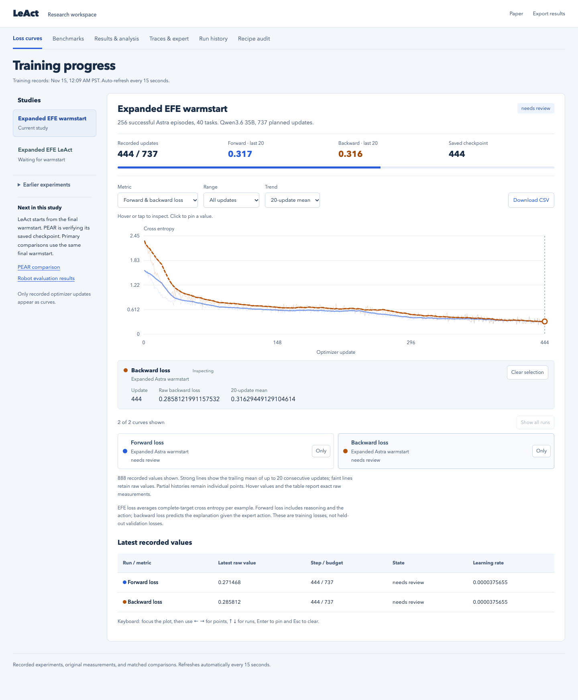

# LeAct, EFE and PEAR branch stack

Source and results snapshot captured on November 15, 2026. The top branch
contains every layer. The stack starts at `main` commit
`9a4194b179836aab8653a1d922cdb24707e51cc5`; it does not depend on the local
simulator development branch.

| Order | Branch | Contents |
| --- | --- | --- |
| 1 | [01-reproduction](https://github.com/GaTech-RL2/EgoVerse/tree/codex/leact-efe-20261115/01-reproduction/reproductions/leact) | Leduc oracle, LeAct/ExIt selection and SFT, Astra/coldstart/projection arms, BuilderBench, shared OSMO helpers and tracking backend. |
| 2 | [02-efe](https://github.com/GaTech-RL2/EgoVerse/tree/codex/leact-efe-20261115/02-efe/reproductions/leact) | EFE task splits, constrained action harness, coverage collection, Qwen warmstart/LeAct, checkpoint recovery, native evaluations and rollout viewers. |
| 3 | [03-pear](https://github.com/GaTech-RL2/EgoVerse/tree/codex/leact-efe-20261115/03-pear/reproductions/leact) | Native group admission, exact sampler probability capture, optional score centering, token-weighted policy gradients and optimizer/restart qualification. |
| 4 | [04-dashboard](https://github.com/GaTech-RL2/EgoVerse/tree/codex/leact-efe-20261115/04-dashboard/reproductions/leact) | Interactive losses, benchmark leaderboards and baseline links, mobile layout, this review guide and frozen results snapshot. |

Each branch builds on the preceding branch. Check out the top branch for the
complete implementation:

```bash
git fetch origin codex/leact-efe-20261115/04-dashboard
git switch --track origin/codex/leact-efe-20261115/04-dashboard
```

## What the evidence currently supports

The machine-readable [status snapshot](experiment-status.json) records its
capture and evidence timestamps. It is a historical snapshot, not a live job
monitor.

- **Leduc:** the frontier warmstart plus two LeAct rounds reached
  `0.007819 ± 0.003090` single-policy exploitability at the final epoch.
  These are seen-state imitation results from one training run and three
  inference seeds. The original README records the other controls and the
  oracle-aware checkpoint selection caveats.
- **Expanded EFE:** 256 successful teacher episodes across 40 tasks admitted
  3,927 decisions / 7,854 paired forward/backward examples. The frozen baseline
  panel has Astra **27/36** successes and base Qwen **5/36**. This two-suite,
  single-attempt panel is not an official full-EFE score.
- **Warmstart:** the captured dashboard has **444/737** updates logged and
  committed; its latest recovery attempt is `NEEDS_REVIEW` after an empty-shard
  restart probe failed. The recorded forward/backward losses are
  `0.27147 / 0.28581`. Expanded LeAct waits for the common final warmstart;
  expanded trained-student task-success measurements are not available.
- **PEAR:** the v2 base-policy qualification executed one discarded update
  using all 512 requests / 1,418,034 generated tokens in the admitted door-lock
  group. The scheduler reports completion, but the collected evidence ends
  during fresh-process verification and contains no final verification result.
  This is not a qualified primary RL result. Both planned primary PEAR arms
  still require the same final warmstart as LeAct.
- **BuilderBench and capability regression:** source and earlier evidence
  remain in the stack; these studies are paused while EFE takes priority.

## Open the frozen dashboard and loss curves

From the repository root, use Python 3.11 and the reproduction's CPU environment:

```bash
uv venv emimic --python 3.11
source emimic/bin/activate
uv pip install -r reproductions/leact/requirements-cpu.txt
mkdir -p reproductions/leact/artifacts/review
gzip -dc reproductions/leact/review/dashboard-snapshot.json.gz > reproductions/leact/artifacts/review/snapshot.json
python -m reproductions.leact.tracking.server import \
  --db reproductions/leact/artifacts/review/tracker.sqlite \
  --snapshot reproductions/leact/artifacts/review/snapshot.json
python -m reproductions.leact.tracking.server serve \
  --db reproductions/leact/artifacts/review/tracker.sqlite --port 8127
```

Open <http://localhost:8127/#loss-efe-expanded>. This serves the frozen snapshot
without submitting jobs or replacing the ongoing experiment's dashboard.
Raw and smoothed curves, exact hover/pinned values, run visibility, ranges and
CSV export remain interactive. The current expanded LeAct panel is explicitly
pending. The rejected first warmstart generation remains separate.

The snapshot preserves loss histories and aggregate benchmark scores. Large
corpus membership lists, per-question capability records and individual trace
diagnoses are omitted; [snapshot provenance](snapshot-provenance.json) lists
those omissions and checksums. Rollout videos and individual trace endpoints
require their separate artifact data. The screenshots below show this
444-update snapshot in the isolated checkout.



[Mobile layout](final-mobile.png)

## Validation and publication scope

Validation passed **309 Python tests and 7 leaderboard tests**. Three Python
tests skipped because their optional data/dependency was absent. Browser checks
verified desktop/mobile navigation, pending-run display and exact plotted
forward/backward means at update 444 without JavaScript errors.
See [validation.json](validation.json) and the
[browser report](browser-check.json) for the checks and limitations.
CPU tests can be run with:

```bash
source emimic/bin/activate
python -m pytest reproductions/leact/tests -q -c /dev/null
node --test reproductions/leact/tests/leaderboards.test.cjs
```

The generalization tests use a versioned task-metadata projection of the frozen
inventory, with source checksums in
[its provenance file](../tests/fixtures/efe-generalization-v2.provenance.json).
The 985-question capability-corpus audit requires separately prepared data and
skips explicitly when absent. LLaMA-Factory template checks require that
optional GPU-training dependency. The unrelated repository-wide `tests/unit`
command cannot collect in the available environment because `hydra` is absent.

The stack contains all 283 source/configuration/test files from this LeAct
checkout, plus review evidence and the portable test fixture.
[Source provenance](source-manifest.json) records their original hashes and
the small publication-only edits. One iCloud-offloaded CPU requirements file
was recovered from an existing frozen source payload; it was not re-created
from guessed package versions.

Generated model weights, optimizer states, raw trajectories, simulator assets,
local databases, credentials and frozen OSMO payloads remain outside Git.
The active experiment checkout and immutable job payloads were not changed.

## Runtime artifacts and launch constraints

These are research controllers configured for the existing OSMO study, not
portable one-command training recipes. Some launchers read frozen manifests,
environment templates and source payloads from `artifacts/` and
`cluster/.build/`; a new checkout alone cannot resume those jobs. Review each
launcher's constants and restore its exact manifests before submitting work.
Keep corpus/model checksums, split boundaries and the committed optimizer state
intact. Never treat a scheduler retry as a new independently trained model.

Existing authorized storage locations:

- Expanded corpus and canonical study root:
  `/mnt/amlfs-01/home/rpunamiya/leact/studies/efe-coverage-20261105-v1`.
- Relocated warmstart and LeAct storage:
  `/mnt/amlfs-07/shared/rpunamiya/leact/studies/efe-coverage-20261105-v1`.
  Retained tensor inputs still depend on the original AMLFS-02 store.
- PEAR qualification:
  `/mnt/amlfs-07/shared/rpunamiya/leact/studies/efe-pear-20261114-v1/optimizer-qualification-v2`.

The current study ceiling is eight concurrent H100 nodes; HIGH priority is
preferred, with LOW retries for verified allocation/infrastructure failures.
Older two-node limits in the historical README describe prior phases.
Authentication must come from the authorized local configuration or environment;
none is included in this stack. The local dashboard was updated; ITSS deployment
of the latest layout remains unverified after SSH authentication failed.
